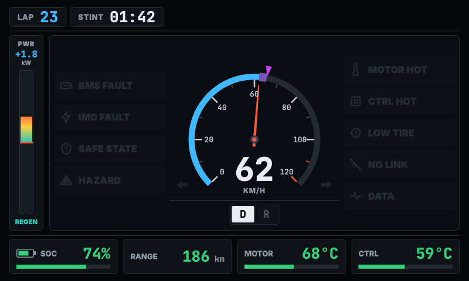

# ORNA – מוקאפ דאשבורד נהג

מוקאפ שרץ של מסך הנהג שעיצבנו לרכב השמש ORNA (iLumen European Solar Challenge).
המסך זהה לעיצוב: 800×480, כל הנתונים והנוריות, ונתונים חיים מסימולטור.
הקוד כתוב ב-Python עם PySide6, כמו ממשק הנהג הקיים של הצוות על ה-Raspberry Pi.

מגישים: שון ורחובסקי, סמיון גליצקי



## הרצה

```bash
pip install -r requirements.txt
python main.py                 # חלון 800×480 עם סימולטור וסרגל בדיקות
python main.py --fullscreen    # על מסך ה-7" ברכב (בלי סרגל הכלים)
python main.py --demo          # מעבר אוטומטי בין כל 19 מצבי העיצוב (להצגה; גם --auto-cycle)
python main.py --state 14      # פתיחה במצב מסוים מהעיצוב (כאן: CAN LOSS)
python -m pytest tests         # בדיקות ללוגיקה ולפענוח CAN (בלי מסך)
python tools/render_states.py docs   # שמירת תמונה לכל מצב מסך
```

הקובץ כותב לתיקייה `logs/` שני קובצי CSV: נתונים גולמיים ב-10 Hz (נשמרים לדיסק פעם בשנייה), ויומן אירועים (הודעות, אישורי OK, פיט, ניתוק).
אפשר לבטל עם `--no-log`.

## מקשים

| מי | מקש | פעולה |
|---|---|---|
| נהג (כפתורי ההגה) | Space | OK: אישור הודעה מהפיט |
| | P | כפתור PIT |
| הרכב (סימולטור) | ← / → | איתות שמאלה / ימינה |
| | Z | Hazard |
| | R | החלפת D / R |
| | B / I / S / T | BMS FAULT / IMD FAULT / SAFE STATE / LOW TIRE |
| | H / J | התחממות מנוע / בקר |
| | C | ניתוק נתוני ה-CAN (CAN LOSS, ואז RECOVERING) |
| הפיט | M | שליחת הודעה (נכנסת לתור) |
| | Shift+P | הדלקת נורית PIT מהפיט |
| | ↑ / ↓ | שינוי יעד המהירות ב-5 קמ"ש |
| | L | ניתוק הקשר לפיט (NO LINK) |
| | N | הקפה חדשה |
| הדגמה | F1 | הפעלה / עצירה של מעבר אוטומטי בין 19 מצבי העיצוב כל 3 שניות |
| | [ / ] או Tab / 0 | המצב הקודם / הבא מהעיצוב / חזרה לסימולציה חיה |
| | F11 / Esc | מסך מלא / יציאה |

מתחת למסך יש סרגל כלים לבדיקות (לא מופיע ב-`--fullscreen`): בחירת מצב מהעיצוב, מעבר אוטומטי, וכפתורים להודעת פיט, OK, PIT וניתוק CAN.

## מבנה הקוד

```
VehicleSource (sim | CAN) ──► DashboardLogic ──► Dashboard (UI)
PitLink (יעד, הודעות, פיט) ──┘        └──► DataLogger (CSV)
```

| קובץ | תפקיד |
|---|---|
| `sources/base.py` | הממשק שכל מקור נתונים מממש: `poll()` |
| `sources/simulator.py` | סימולטור: מהירות סביב היעד, הספק ורגנרציה, ירידת SOC, חימום |
| `sources/can_source.py` | מקור CAN אמיתי (python-can + קובץ DBC). קורא ב-thread נפרד לכל ערוץ כדי לא לאבד הודעות; הודעה פגומה לא מפילה אותו; אם הממשק לא נפתח המסך מציג CAN LOSS ומנסה שוב כל 3 שניות. נבדק על CAN וירטואלי, **לא על הרכב** |
| `pitlink.py` | הקשר לפיט: יעד מהירות, הודעות, נורית PIT. כאן מדומה מהמקלדת |
| `logic.py` | כל ההחלטות: ספים לאזהרות, CAN LOSS, RECOVERING, NO LINK, תור הודעות, נעילת PIT, צבע היעד |
| `ui/dashboard.py` | ציור המסך לפי העיצוב. רק מצייר, לא מחליט |
| `datalog.py` | שמירת נתונים גולמיים ואירועים ל-CSV |
| `config.py` | כל הספים והסקאלות במקום אחד |
| `presets.py` | 19 מצבי המסך מהעיצוב, לסרגל הכלים ולשמירת תמונות |

## מעבר לרשת ה-CAN האמיתית

הממשק לא תלוי במקור הנתונים, ולכן מחליפים רק את המקור:

```bash
pip install python-can cantools
python main.py --source can --dbc orna.dbc --fullscreen
python main.py --source can --dbc orna.dbc --channels can0 can1 --bitrate 500000
```

מה צריך להשלים לפני שזה עובד ברכב:
1. ב-`sources/can_source.py`, לעדכן את `SIGNAL_MAP` לשמות האותות בקובץ ה-DBC של הצוות (בקר המנוע, BMS ומודול ה-GPS/טמפרטורה).
2. לחבר את קשר הפיט האמיתי (היום Firebase / FastAPI) במקום `SimulatedPitLink`, עם אותן פונקציות.
3. לחבר את כפתורי OK ו-PIT שעל ההגה (למשל דרך GPIO) לפונקציות `ok_pressed()` ו-`pit_pressed()` שב-`logic.py`.

## הנחות שצריך לאשר עם הצוות (`config.py`)

מהירות מקסימלית 120 קמ"ש, הספק מקסימלי 5 kW ורגנרציה 2.5 kW, ספי חום (מנוע 95°C, בקר 85°C), ספי SOC לצבע (30% / 15%).
ערכי הסימולטור (גודל סוללה, צריכה) לא מייצגים את הרכב האמיתי.

## פונטים

Inter ו-JetBrains Mono, שניהם ברישיון SIL Open Font License (קובצי הרישיון בתיקייה `fonts/`).
