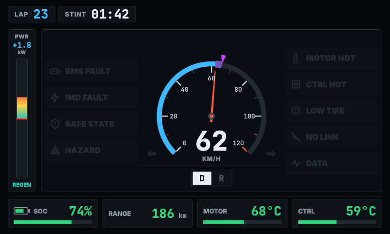
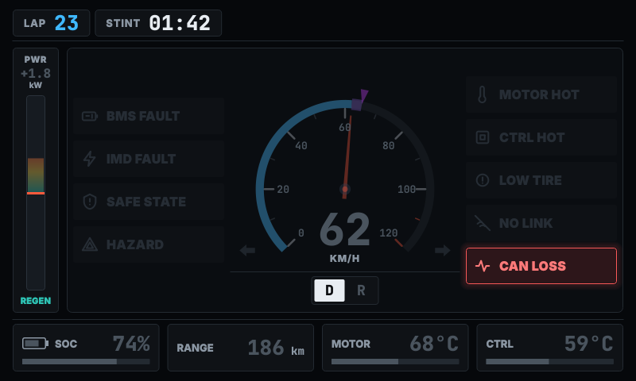
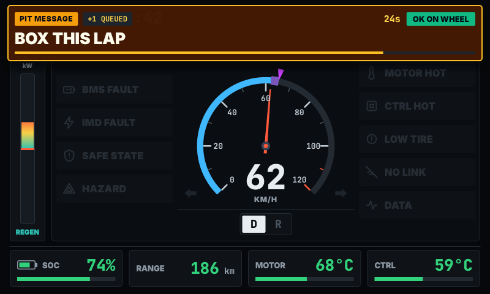
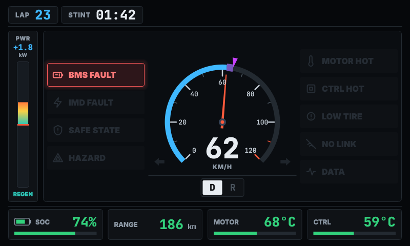

# ORNA driver display: working prototype

A working prototype of the driver display we designed for **ORNA**, the Afeka car club's solar car (iLumen European Solar Challenge). It matches the design exactly: an 800×480 screen with every reading and warning light, fed live by a simulator. Written in Python with PySide6, like the team's existing driver interface on the Raspberry Pi.

**Authors:** [Shon Verkhovskiy](https://github.com/ShonVerh), [Semyon Galitsky](https://github.com/SemyonGalitsky) ([Hebrew README](README.he.md))

> **Context.** This was built as part of our entry research assignment for the club's software team. We researched telemetry systems, analysed the team's previous 24-hour race, and wrote the display and telemetry specification ourselves; the code was written with AI assistance to turn that design into a running prototype quickly. It runs on a simulator. The real CAN input is implemented and tested on a virtual CAN bus with a sample DBC file, but it has **not been run on the car**, and the team's own DBC file is not part of this repository.



| | | |
|---|---|---|
|  |  |  |
| CAN LOSS | Message from the pit | BMS FAULT |

## Running it

```bash
pip install -r requirements.txt
python main.py                 # 800×480 window with the simulator and a test toolbar
python main.py --fullscreen    # on the car's 7" screen (no toolbar)
python main.py --demo          # cycles through all 19 design states (for showing it; also --auto-cycle)
python main.py --state 14      # opens in one design state (here: CAN LOSS)
python -m pytest tests         # tests for the logic and the CAN decoding (no screen needed)
python tools/render_states.py docs   # saves a picture of every screen state
```

The app writes two CSV files to `logs/`: raw data at 10 Hz (flushed to disk once a second) and an event log (messages, OK confirmations, pit calls, disconnections). Turn it off with `--no-log`.

## Keys

| Who | Key | Action |
|---|---|---|
| Driver (steering-wheel buttons) | Space | OK: acknowledge a message from the pit |
| | P | PIT button |
| The car (simulator) | ← / → | Turn signal left / right |
| | Z | Hazard |
| | R | Switch D / R |
| | B / I / S / T | BMS FAULT / IMD FAULT / SAFE STATE / LOW TIRE |
| | H / J | Motor / controller overheating |
| | C | Cut the CAN data (CAN LOSS, then RECOVERING) |
| The pit | M | Send a message (goes into a queue) |
| | Shift+P | Turn on the PIT light from the pit |
| | ↑ / ↓ | Change the speed target by 5 km/h |
| | L | Cut the link to the pit (NO LINK) |
| | N | New lap |
| Demo | F1 | Start / stop cycling through the 19 design states every 3 seconds |
| | [ / ] or Tab / 0 | Previous / next design state / back to the live simulation |
| | F11 / Esc | Fullscreen / exit |

Under the screen there is a test toolbar (hidden with `--fullscreen`): pick a design state, auto-cycle, and buttons for a pit message, OK, PIT and cutting the CAN data.

## How the code is organised

```
VehicleSource (sim | CAN) ──► DashboardLogic ──► Dashboard (UI)
PitLink (target, messages, pit) ──┘        └──► DataLogger (CSV)
```

| File | Role |
|---|---|
| `sources/base.py` | The interface every data source implements: `poll()` |
| `sources/simulator.py` | Simulator: speed around the target, power and regeneration, falling state of charge, heating |
| `sources/can_source.py` | Real CAN source (python-can + a DBC file). One reader thread per channel so no frames are lost; a malformed frame doesn't crash it; if the interface won't open, the screen shows CAN LOSS and retries every 3 seconds. Tested on a virtual CAN bus, **not on the car** |
| `pitlink.py` | The link to the pit: speed target, messages, PIT light. Simulated from the keyboard here |
| `logic.py` | Every decision: warning thresholds, CAN LOSS, RECOVERING, NO LINK, the message queue, PIT lock, the target colour |
| `ui/dashboard.py` | Draws the screen to the design. It only draws; it decides nothing |
| `datalog.py` | Saves raw data and events to CSV |
| `config.py` | Every threshold and scale in one place |
| `presets.py` | The 19 screen states from the design, for the toolbar and for saving pictures |

## Moving to the real CAN network

The display doesn't depend on where the data comes from, so only the source changes (on Linux, through SocketCAN):

```bash
pip install python-can cantools
python main.py --source can --dbc orna.dbc --fullscreen
python main.py --source can --dbc orna.dbc --channels can0 can1 --bitrate 500000
```

What has to be done before it works in the car:
1. In `sources/can_source.py`, update `SIGNAL_MAP` to the signal names in the team's DBC file (motor controller, BMS and the GPS/temperature module). The names there now are placeholders.
2. Connect the real pit link (today Firebase / FastAPI) in place of `SimulatedPitLink`, with the same functions.
3. Wire the OK and PIT buttons on the steering wheel (for example through GPIO) to `ok_pressed()` and `pit_pressed()` in `logic.py`.

## Assumptions to confirm with the team (`config.py`)

Top speed 120 km/h, maximum power 5 kW and regeneration 2.5 kW, temperature limits (motor 95°C, controller 85°C), state-of-charge colour thresholds (30% / 15%). The simulator's values (battery size, consumption) don't represent the real car.

## Fonts

Inter and JetBrains Mono, both under the SIL Open Font License (licence files in `fonts/`).
